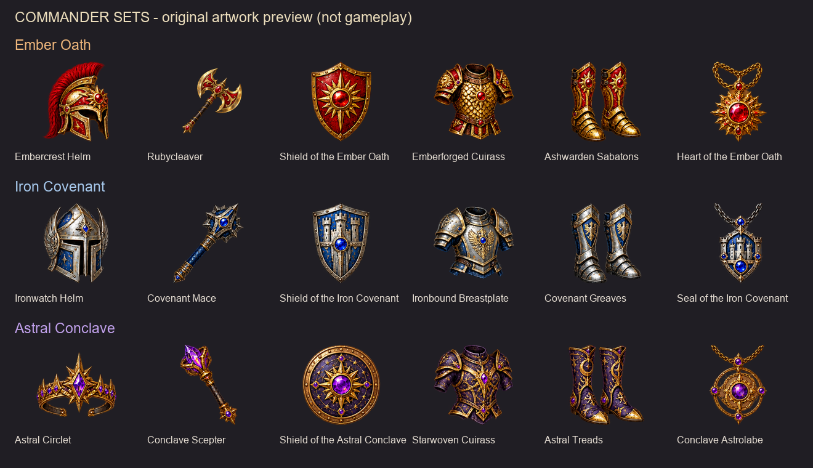

# Commander sets

Three universal sets, six items each. All nine standard towns and all ACM
commander classes can use every set. The sets share acquisition costs and a
480-point full-set attribute budget; actual combat balance awaits player review.

| Set | Favored modifiers | Items |
| --- | --- | --- |
| Ember Oath | Attack, Damage | Embercrest Helm; Rubycleaver; Shield of the Ember Oath; Emberforged Cuirass; Ashwarden Sabatons; Heart of the Ember Oath |
| Iron Covenant | Defense, Health | Ironwatch Helm; Covenant Mace; Shield of the Iron Covenant; Ironbound Breastplate; Covenant Greaves; Seal of the Iron Covenant |
| Astral Conclave | Spell, Passive | Astral Circlet; Conclave Scepter; Shield of the Astral Conclave; Starwoven Cuirass; Astral Treads; Conclave Astrolabe |

Original artwork preview, not a gameplay screenshot. Native icons use the
existing44x44 inventory palette with clear margins. Artwork is pending player
approval and may be revised following feedback.

## Equip and obtain

In the hero screen press **Ctrl+N**, then **Commander equipment and forge**.
Use the separate Helm, Weapon, Shield, Armor, Boots and Pendant positions on
this commander page. Select a position and choose a matching item from the hero's
backpack. The item transfers into commander equipment. Removing it returns it to
the backpack; make room first. Swapping returns the former item safely.

Items in hero equipment or a backpack give **no commander bonus**. A native
commander item reserves its existing numbered position and suppresses our same
position. Remove the native item through the ordinary commander screen before
using that position for new gear. Existing items are not replaced or converted.
You may remove retained new gear even while the commander is dead or a native
item reserves its position. A disabled or dead commander gets no custom bonus.

**Forge:** hero level20, enabled living commander,50000Gold,20Wood and20Ore for
each item. A complete set costs300000Gold,120Wood and120Ore. Every item enters the
backpack first; forging never silently equips it. Every town gets the same costs.
Each of these18items also appears exactly3times in the explicit new-map plan,
alongside3copies of each of72faction components:270finds. Full relics never
appear on the map. Ordinary native random-loot and level-up pools remain unchanged. AI cannot receive or
activate the new items; human-owned items remain subject to normal loss/transfer.

## Bonuses

Each active part adds **5 percentage points** to all eight ACM commander
attribute modifiers: Attack, Defense, Damage, Health, Speed, Spell, Passive and
Aura. Matching2/4/6 parts add another5/5/10 points to all eight. A complete set
adds40 further points to its favored pair.

Full set: **50 points to every modifier,90 to the favored two**. These are added
to ACM's existing modifiers. For example, an existing100% Damage modifier becomes
190% with a complete Ember Oath; an existing200% becomes290%, rather than380%.
No hero stat, learned ability or commander class is replaced. Mixed sets retain
their individual and earned same-set thresholds, without a full-set favored bonus.

## Comparison with existing equipment

The shipped WoG feature manual describes native commander equipment with growing
bonuses: Axe of Smashing gives5Attack and1 more per6victories; Mithril Mail
gives12%Health plus1 point per victory; Sword of Sharpness gives12%Damage plus1
point per victory; Pendant of Sorcery and Boots of Haste improve their respective
stats with victories. Other items offer revival, shooting, dragon properties or
advanced skills. Native utility effects are intentionally retained.

ACM changes this baseline. Its commander calculation gives10 points to all eight
modifiers for each worn Bow of Seeking, Dragon Eye Ring and Slava's Ring, plus
15Spell points and win scaling for Pendant of Sorcery. It also changes artifact
effects when those artifacts are worn by the hero. This is why new commander
gear is measured against the ACM calculation, rather than old tooltip text alone.

Our full sets offer a larger broad attribute budget and a role bonus. They do
not promise to beat every native utility effect or unbounded victory counter
in every situation. Further balance changes will follow actual play feedback.

## Compatibility and acceptance

The integration reads the documented six native positions without writing new
IDs into the native commander table. It augments ACM1.11's normal eight returned
modifiers while preserving class previews and alternate resistance results.
JS commanders1.02 and WoG commander settings are not changed. Difficulty Mod's
neutral commanders have no eligible human equipment. Arena bonuses remain part
of ACM's baseline. Enhanced Henchmen's separate Warlord Banner is untouched.

Source review covered the current installed profile of36active mods and54LOD/PAC
archives; no conflicting new artifact configuration IDs were found. This is
not certification for every mod, unpublished plugin or future update. Existing
distribution incompatibilities remain: Knightmare Kingdoms, ERA+, Land Of New
Towns, ResOunD and TUM Enchanted. Keep a matching complete profile on both peers.

No game was controlled or updated during development. Headless fixtures and
package gates do not establish native rendering, native save/load or actual
two-computer synchronization. Start a **NEW map** on matching dev31 clients.
First acceptance: forge one item, equip it on the commander page, inspect its
ACM attributes, then unequip it and verify that the bonus disappears. Follow
with save/load and a shared Lobby check before relying on the complete feature.
