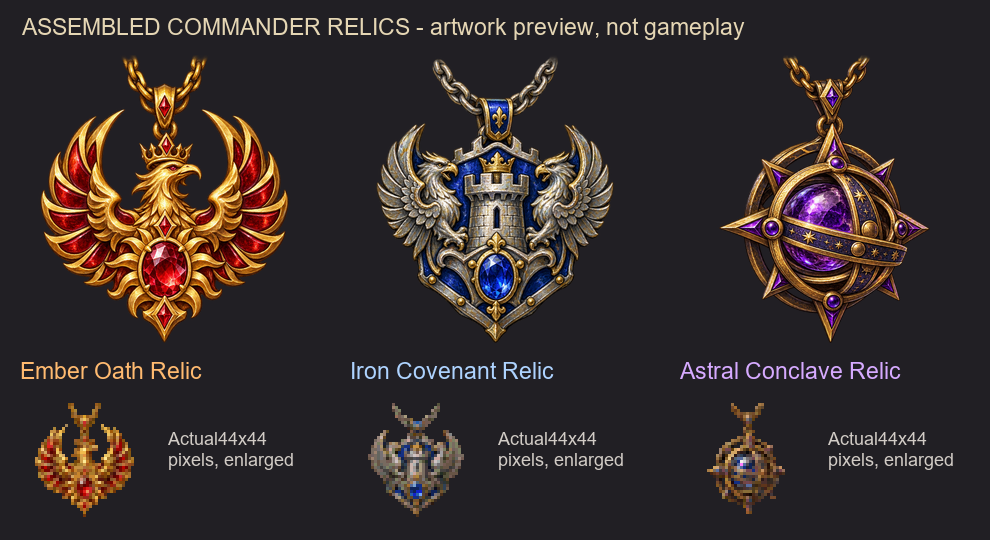

# Commander artifacts - dev36

## Obtain and equip

Find individual parts on the map or after battle. Each confirmed human victory
has a5%chance to discover one random part from the18commander parts. All three
sets are eligible for every town and commander class. No whole relic is awarded.
AI receives no custom artifact. Ordinary battle loot remains unchanged.
Rewards enter the backpack and show the normal artifact picture; they never
silently equip. A full backpack consumes that attempt without rerolling.

The map still contains exactly two copies of each of72hero-set parts and18
commander parts:180finds,90/90with underground. Separate adventure-map monsters
and ordinary native guarding/movement rules are unchanged. Hero-set parts at
levels18,25,32,39and every7levels thereafter remain separate and unchanged.

Pick up an item from the backpack and give it to the normal Commander icon.
It occupies one of the actual six Commander-screen slots. Click its icon there
to return it to the backpack; make room first. New commander items cannot be
worn on the hero. There is no separate equipment menu or purchase with resources.
Carried items give no bonus; disabled/dead or AI commanders get no custom bonus.

## Assemble and dismantle on the item

Equip all six different matching parts on the Commander, then right-click one
of them. Confirm assembly in the normal Yes/No artifact dialog. The Commander
window closes before the change is committed; the six parts become one equipped
relic in the clicked slot. Five slots become available for other artifacts.
Reopen the Commander screen to inspect it. Declining changes nothing.

Right-click an equipped relic to confirm dismantling. Original equipped items
and all their accumulated battle counts remain unchanged. Parts fill free
commander positions; any remainder goes into free backpack cells. If there is
insufficient room, the entire change is refused without losing the relic or
other items. This has no resource, hero-level or commander-level price.
Backpack parts must be equipped before assembly; full relics never drop.

## Sets and bonuses

| Set | Favored modifiers |
| --- | --- |
| Ember Oath | Attack, Damage |
| Iron Covenant | Defense, Health |
| Astral Conclave | Spell, Passive |

Each active part adds5percentage points to all eight ACM modifiers: Attack,
Defense, Damage, Health, Speed, Spell, Passive and Aura. Matching2/4/6parts add
another5/5/10points to all eight. A full set adds40more to its favored pair.
Two matching parts therefore give15to all eight. A complete set or relic gives
50to all eight and90total to the favored two; thresholds are included, not
added twice. Existing ACM bonuses and original artifact abilities/growth remain.
Represented same-set parts do not duplicate their relic's bonuses.

Green N/6 headings, active part names and earned thresholds reflect actual
commander equipment. Backpack/hero equipment do not count. An equipped relic
represents6/6. Ordinary artifacts show their original descriptions.

## Updating and acceptance

Close the game before updating, restart fully and use matching dev36 clients
with a NEW map. Old saved scripts are not migrated; do not use F12. Keep the
metadata-listed dependencies and incompatibilities. The native dialog bridge
checks the shipped instruction contracts after providers have loaded.

Targeted headless production-code, authored ERM and package checks pass; actual
native UI, combat, real save/load and two-computer acceptance remain pending.
No game, installed file, setting or save was changed during this development.
First acceptance: equip all six matching parts, right-click and confirm, inspect
the relic and five free slots, wear an original bow and verify its retained
utility, then dismantle with/without backpack space. Check battle rewards over
multiple victories;5%does not mean a guaranteed item after any fixed count.
