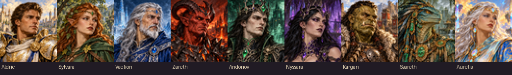

LATEST PUBLIC BUILD: 0.6.0-batch-dev18

--------------------------------------------------------------
## CHANGELOG

20/10/2026 dev17 > dev18
- Separate adventure-map frame names from inventory names for all64 added faction components, correcting the resource-cache conflict behind clipped map icons. Tower names and all item artwork are unchanged.
- Add a release check against conflicting frame names across all bundled DEF resources.

20/10/2026 dev16 > dev17
- Rebuild all72 map component sprites and their visibility masks as single-cell resources. Targets the reported half-visible artifacts; terrain acceptance is pending.
- Show the current build and this changelog before the mod description.

20/10/2026 dev15 > dev16
- Enlarge all72 component map drawings and retain more faction colors with separate map palettes.
- Add27 large gallery images: individual champions, complete faction sets and assembled relic close-ups.

20/10/2026 dev14 > dev15
- Fix an invalid native startup call that caused an ERM error while loading a new map.

20/10/2026 dev13 > dev14
- Increase map component budgets by10% on every map size; keep equal surface/underground counts.
- Reduce component quest targets by a further5%.
- Add native AI artifact grant guards and safe-event cleanup; native enforcement acceptance is pending.

19/10/2026 dev12 > dev13
- Harden champion delivery retries, completed map-plan validation and quest counter overflow handling.

--------------------------------------------------------------

## LEGACY OF THE CLOUD TITANS - TEST

Collect your town's artifacts, assemble its legendary relic and earn a unique faction champion.

Legacy of the Cloud Titans adds an artifact-collection and hero-progression system to all nine standard towns in Heroes III ERA: Castle, Rampart, Tower, Inferno, Necropolis, Dungeon, Stronghold, Fortress and Conflux. Explore the map for components, complete faction objectives and build a matching collection that strengthens your hero and army.

## WHAT YOU GET

- Nine faction sets: eight components and one assembled relic for each town.
- 72 components and nine complete relics in total, with themed artifact artwork.
- Individual item effects and cumulative bonuses for wearing different matching pieces.
- Faction artifact quests with objective descriptions and progress tracking.
- Eight manual relic powers, plus Tower's automatic lightning mechanic.
- Nine champion quests with named heroes, custom portraits and faction specializations.
- A relic-to-town link that increases weekly recruitment of the faction's top-tier creature.

## FIND AND EARN COMPONENTS

Map exploration: some eligible loose artifact sites become faction components when a new map is prepared. Finds can belong to any town. On maps with an underground level, the generated plan keeps equal component counts above and below ground. Availability depends on valid locations; exploring a particular area does not guarantee a component.

Faction quests: open Faction set quests in your town menu. Each component has an objective and a progress counter. Defeat the listed enemies or complete the required battles, then return with a qualified matching-faction hero to claim it. Read the selected objective for its level and town requirements. Progress is shared by your heroes; each quest offers one copy per player. Finding a piece elsewhere does not consume that quest reward.

Level-up rewards: with WoG option 126 enabled, eligible human Relic-category level-up rewards can offer a matching-faction component. The component gate is 5% from level 18, with at least ten levels between component selections. This is a rare extra route, not a guaranteed reward every ten levels.

Custom relics are assembled from components; Dragon Utopia does not award a complete custom set. Level-up and faction-quest component rewards follow the hero's faction. A foreign-faction component found on the map is allowed.

## WEAR A SET AND ASSEMBLE ITS RELIC

Different worn pieces unlock cumulative set bonuses. Components in the backpack do not count, and extra copies of the same piece do not multiply those bonuses. Item descriptions explain the effects and equipment slots.

Collect all eight different components and use the assemble/disassemble action in the faction quest menu. The assembled relic represents the full collection. Its slot depends on the relic. Disassembly returns the components to the backpack, so leave enough space.

Visit a matching owned developed town while wearing the relic to link its weekly top-tier recruitment bonus. The highest-level dwelling is required.

## USE YOUR RELIC'S BATTLE POWER

For the eight manual powers, wear the assembled relic and open the battle spellbook on your own stack's turn after Tactics. Select Relics at the bottom, then the set's icon. Eight separate components do not unlock the manual power. Each relic has one manual activation per battle and a mana cost; canceling spends nothing.

- Castle: Seraphic Restoration restores fallen troops using a shared resurrection allowance.
- Rampart: Forest's Embrace combines protection with healing for its top creatures.
- Inferno: Infernal Gate summons temporary Horned Demons.
- Necropolis: Life Harvest damages living enemies and restores undead troops. Its relic also adds 30% Life Leech to controlled units' physical attacks against living enemies.
- Dungeon: Abyssal Rift strikes a selected target with Implosion.
- Stronghold: Warlord's Fury combines Haste with Attack-based physical damage.
- Fortress: Primordial Venom opens a limited Poison window.
- Conflux: Elemental Invocation offers four elemental choices.

Tower uses automatic lightning for Giants, Titans and Lords of Thunder instead of a manual spellbook power. Supported creature upgrades are included in the relevant faction effects; commanders and war machines are excluded from regular-troop bonuses.

## EARN YOUR FACTION CHAMPION

Choose Champion quest in a matching owned town to enroll and view the reward and progress checklist. Enrollment is available before you meet the battle requirements.

To count the five qualifying victories, use a level-25 hero carrying four distinct matching components, or the assembled relic, and meet the town-building requirements. Commanders must be enabled. Fight with that faction's regular troops; commanders and war machines do not invalidate the army. The Grail is not required.

After the victories, leave town and Alt-left-click your own adventure hero to begin the final trial. Return to the matching town with a free visitor space and fewer than eight heroes to receive the champion. A blocked delivery keeps the reward pending.

Castle: Aldric. Rampart: Sylvara. Tower: Vaelion. Inferno: Zareth. Necropolis: Andonov. Dungeon: Nyssara. Stronghold: Kargan. Fortress: Ssareth. Conflux: Aurelis.

Champions start at level 1 with 10 Attack, 10 Defense, 10 Spell Power, 10 Knowledge and a matching commander. Their faction specialization works without wearing the set. Andonov has stronger faction bonuses.

## STARTING A GAME

Requires Heroes III ERA, WoG, Era Erm Framework, WoG Scripts, Game Enhancement Mod and Advanced Classes Mod. Enable one copy of Legacy of the Cloud Titans - TEST and start a NEW map. Keep old saves with their matching mod version. Close the game before updating; do not use F12 to update a running game.

The current trial profile keeps Knightmare Kingdoms, the Full/Lite HD remaster packages and the other packages listed as incompatible in mod.json disabled. Support for one creature's upgrades does not establish compatibility with every creature pack.

For an online test, both players need the same build, dependencies, mod order and WoG options. Use sequential turns. Local gameplay, native AI artifact exclusion, save/load and two-computer Online Lobby acceptance are still under testing. This is an experimental release; the earlier AI-turn and fullscreen crashes have no established fix.

## REPORTING A PROBLEM

Keep the save and Debug folder locally. Record the installed version, faction, exact action and a screenshot of the first error. Include whether it happened locally or through Online Lobby. Detailed test instructions are in NETWORK_TEST.md.

## Artwork gallery

[View all nine champion portraits, faction sets and relic close-ups](GALLERY.md). Artwork previews; not gameplay screenshots.
